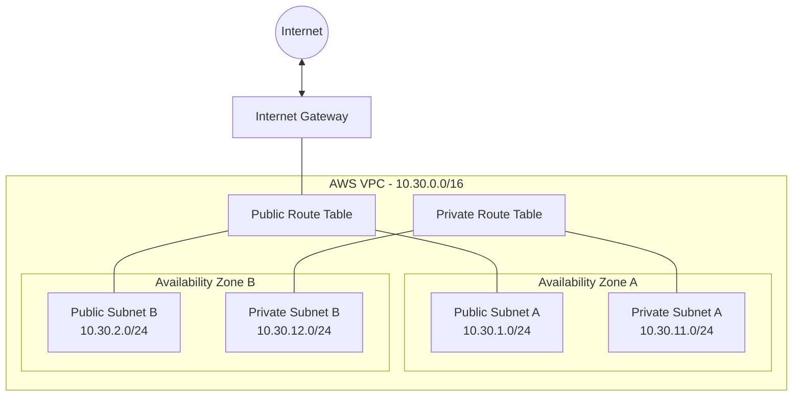

# AWS Infrastructure Automation with Terraform

## Project Overview

This project demonstrates Infrastructure as Code (IaC) using Terraform to provision and manage AWS networking infrastructure.

Instead of manually creating resources through the AWS Management Console, Terraform is used to define and deploy the infrastructure in a repeatable and consistent manner.

The project focuses on building a structured AWS network environment with public and private subnets distributed across two Availability Zones.

**Cloud Provider:** Amazon Web Services (AWS)

**Infrastructure as Code:** Terraform

**AWS Region:** Asia Pacific (Sydney) - `ap-southeast-2`

## Architecture

The infrastructure consists of an AWS VPC with four subnets distributed across two Availability Zones.

- Two public subnets with internet routing through an Internet Gateway.
- Two private subnets with local VPC routing only.
- A public route table associated with both public subnets.
- A private route table associated with both private subnets.
- A web server security group allowing inbound HTTP traffic on TCP port 80.

### Architecture Diagram



## Infrastructure Components

| Component | Configuration | Purpose |
|---|---|---|
| VPC | 10.30.0.0/16 | Provides an isolated AWS network |
| Public Subnet A | 10.30.1.0/24 | Hosts resources requiring internet connectivity |
| Public Subnet B | 10.30.2.0/24 | Provides a second public subnet in another AZ |
| Private Subnet A | 10.30.11.0/24 | Host internal resources |
|Private Subnet B | 10.30.12.0/24 | Provides a second private subnet in another AZ |
| Internet Gateway | Attached to VPC | Enables internet routing for public subnets |
| Public Route Table | Default route to Internet Gateway | Routes public subnet traffic to the internet |
| Private Route Table | Local VPC route only | Keeps private subnet routing internal |
| Security Group | HTTP TCP/80 inbound | Allows HTTP traffic to web resources |


## Project Structure

```text
aws-terraform-infrastructure/
├── main.tf                  # AWS infrastructure resources
├── variables.tf             # Input variable definitions
├── outputs.tf               # Infrastructure output values
├── terraform.tfvars         # Variable values (not committed)
├── .terraform.lock.hcl      # Provider dependency lock file
├── .gitignore               # Files excluded from Git
└── README.md                # Project documentation
```

## Prerequisites

Before deploying this infrastructure, ensure the following tools are installed and configured:

- **Terraform** – Used to define and provision AWS infrastructure.
- **AWS CLI** – Used to interact with AWS services.
- **Git** – Used for version control.
- **AWS Account** – An active AWS account with permissions to create VPC networking resources.

AWS credentials must be configured locally before running Terraform.

Verify your installations:

```powershell
terraform version
aws --version
git --version
aws sts get-caller-identity 

## Deployment

Clone the repository:

```bash 
git clone https://github.com/Jaredtest-hub/aws-terraform-infrastructure.git
cd aws-terraform-infrastructure
```

Intialize Terraform:

```bash
terraform init
```

Validate the configuration:

```bash
terraform validate
```

Preview the infrastructure changes:

```bash
terraform plan
```

Deploy the infrasture:

```bash
terraform apply
```

Review the proposed changes and type 'yes' when prompted to confirm deployment. 


## Cleanup

To remove the AWS infrastructure created by this project, run:

```bash
terraform destroy
```

Review the resources Terraform proposes to delete and type `yes` when prompted.

**Note:** This command deletes the infrastructure managed by the current Terraform configuration. Ensure you are targeting the correct AWS account and region before proceeding.


## Cost Considerations

This project uses AWS networking resources designed to minimise ongoing costs.

- VPCs, subnets, route tables, Internet Gateways, and security groups do not have hourly charges.
- No NAT Gateway is deployed to avoid additional hourly and data processing costs.
- No EC2 instances are deployed in the current configuration.
- AWS public IPv4 address charges may apply if public IPv4 addresses are allocated.

Always review AWS pricing and monitor your account for unexpected charges.


## Future Improvements

Potential enhancements for this project include:

- Deploy EC2 instances into public and private subnets.
- Implement NAT Gateways to provide outbound internet access for private subnets.
- Add Application Load Balancers for distributing web traffic.
- Configure remote Terraform state storage using Amazon S3.
- Implement state locking to support collaborative infrastructure management.
- Integrate Terraform with GitHub Actions for automated deployment.


## Author

**Jared Ortega**

GitHub: [Jaredtest-hub](https://github.com/Jaredtest-hub)